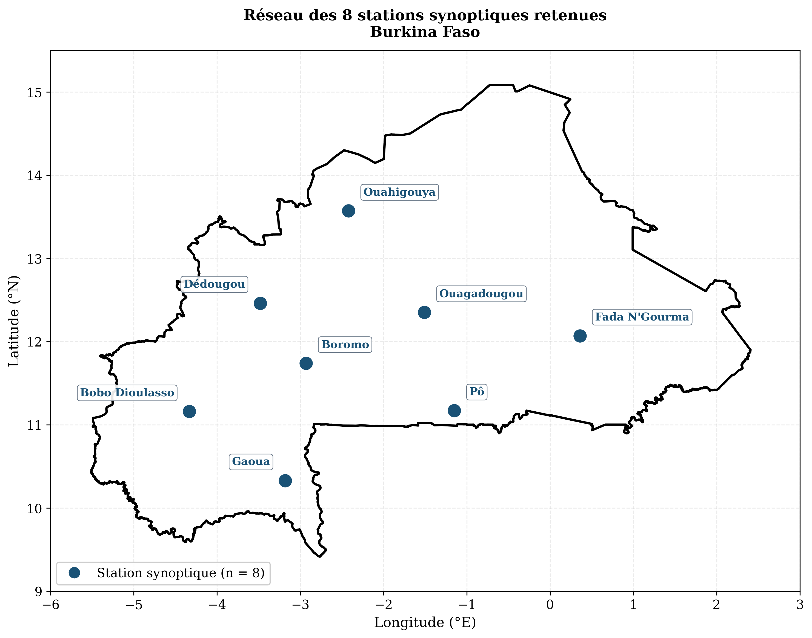
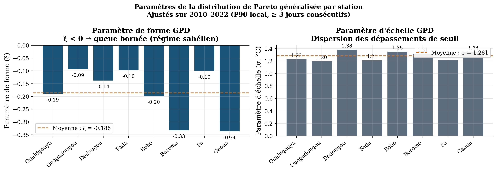
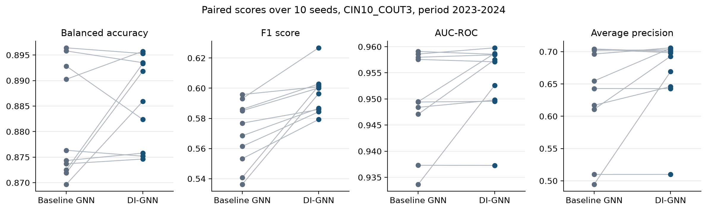
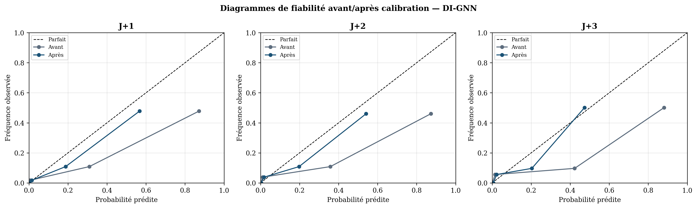

# DI-GNN: probabilistic heatwave forecasting in Burkina Faso

This repository contains the code of my MSc thesis at the Université Virtuelle du Burkina Faso.
It forecasts heatwave occurrence at Burkinabè synoptic stations, 1 to 7 days ahead, with a graph neural network informed by extreme value theory.



## Motivation

Heatwaves are a growing health risk in the Sahel.
Operational services need forecasts that are probabilistic, station-based and focused on the tail of the temperature distribution.
This work tests whether adding extreme value descriptors to a station graph model improves heatwave detection.

## Method

**Heatwave definition.** A heatwave is a run of at least 3 consecutive days above the station 90th percentile of maximum temperature (Perkins and Alexander, 2013).

**Extreme value analysis.** A Generalized Pareto Distribution is fitted to maximum temperature at each station with a Peaks-Over-Threshold approach.
Its parameters feed the model in two ways: as station input features, and as edge weights in the station graph.

**Inputs.** 20 daily features per station: past heatwave label, Tmax, Tmin, dew point, relative humidity, wind speed, precipitation, sea level pressure, coordinates, day-of-year encoding, ONI and NAO indices, the 90th percentile threshold and five GPD descriptors.

**Architecture.** Both models share the same structure:

1. **Temporal encoding.** A GRU encodes the last `C_IN` days at each station.
2. **Spatial encoding.** Two graph attention layers (GAT, 4 heads) share information between stations.
3. **Output.** A two-layer perceptron gives the heatwave probability for each of the next `C_OUT` days at all stations at once.

The graph links stations whose mean absolute Pearson correlation of Tmax and precipitation exceeds 0.3.
The graph attention layers are implemented directly in PyTorch, without a graph library.

**What DI-GNN changes.** The baseline GNN uses the plain correlation graph and a weighted cross-entropy loss.
DI-GNN differs in two points only:

- each edge is scaled by the GPD weights of its two stations, w = 1 + |ξ| + σ / σ_max;
- training uses a combined loss, half weighted cross-entropy and half soft F-beta with β = 2, which favours detection.

Uncertainty is estimated with Monte Carlo Dropout (50 stochastic passes).



## Data

- 8 synoptic stations, 2010 to 2024; Dori is excluded because of a gap longer than 60 days
- Training period 2010 to 2022, evaluation period 2023 and 2024
- 553 heatwave events; about 7 % of station-days are heatwave days
- The fitted GPD shape parameter is negative at all stations (ξ between −0.34 and −0.09), which indicates a bounded upper tail

Station data belong to ANAM-BF and cannot be redistributed.
A script generates a synthetic dataset with the same format, so that the full pipeline can be run (see `data/README.md`).

## Results

Reference configuration CIN10_COUT3: 10 input days, 3 forecast days.
Both models were trained with 10 random seeds (42 to 51) and scored on the 2023–2024 period.

| Metric | DI-GNN | Baseline GNN | DI-GNN better (seeds) | Wilcoxon p |
|---|---|---|---|---|
| F1 score | 0.596 ± 0.014 | 0.570 ± 0.021 | 10 / 10 | 0.002 |
| Precision | 0.452 ± 0.017 | 0.421 ± 0.021 | 10 / 10 | 0.002 |
| Balanced accuracy | 0.886 ± 0.009 | 0.881 ± 0.011 | 6 / 10 | 0.32 |
| Recall | 0.877 ± 0.021 | 0.882 ± 0.018 | 4 / 10 | 0.49 |
| AUC-ROC | 0.954 ± 0.007 | 0.950 ± 0.009 | 7 / 10 | 0.06 |
| Average precision | 0.667 ± 0.060 | 0.634 ± 0.078 | 7 / 10 | 0.11 |

Values are mean ± standard deviation over the 10 seeds.
DI-GNN improves precision and F1 consistently, with a similar detection rate.
Differences in balanced accuracy and AUC stay within seed-to-seed variability.



**Probabilistic skill.** The raw MC Dropout probabilities discriminate well but are overconfident.
For CIN10_COUT3, the Brier skill score falls from 0.41 at day 1 to 0.03 at day 3.
A per-horizon Platt recalibration raises it above 0.3 at all three horizons (see `results/calibration_results_cin10_cout3.json`).



All numbers above can be recomputed from `results/` with `python scripts/summarize_seeds.py`.

## Limitations

These points are known and will be addressed in future work.

- The 2023–2024 period is used both for early stopping and for scoring. There is no separate held-out test period, so scores are likely optimistic.
- The station graph and the missing-value imputation use statistics computed over the whole 2010–2024 period.
- The past heatwave label is an input feature. It gives the model a strong persistence signal, and a persistence baseline is not yet reported.
- DI-GNN and the baseline differ in both the graph weighting and the loss function, so the gain cannot be attributed to one of them alone.
- The loss supports station-level GPD weights, but they are not passed during training, so the F-beta term weights all stations equally.
- The Platt calibration is fitted and scored on a random split of overlapping sequences from the same period.

## Repository structure

```
dignn-heatwave-bf/
├── src/dignn/
│   ├── config.py           paths, windows, heatwave definition, hyperparameters
│   ├── io.py               loading of GSOD observations and ONI / NAO indices
│   ├── quality.py          missing data, ANAM cross-validation, filtering, imputation
│   ├── labels.py           heatwave labels and event statistics
│   ├── evt.py              GPD fitting with a Peaks-Over-Threshold approach
│   ├── graph.py            Pearson and GPD-weighted adjacency matrices
│   ├── features.py         features, normalisation and input/output sequences
│   ├── preprocess.py       full preprocessing pipeline
│   ├── models/             DI-GNN, baseline GNN and loss functions
│   ├── train.py            training with early stopping
│   ├── evaluate.py         deterministic and MC Dropout evaluation
│   ├── metrics.py          Brier score, reliability and ROC helpers
│   ├── calibration.py      per-horizon Platt calibration
│   ├── summary.py          Markdown summary of all results
│   └── plotting/           data figures, result figures and maps
├── scripts/
│   ├── make_synthetic_data.py
│   ├── run_seeds.sh        10-seed comparison of DI-GNN and the baseline
│   ├── run_ablation.sh     6 (C_IN, C_OUT) configurations
│   └── summarize_seeds.py  table and figure of the 10-seed comparison
├── results/                aggregated scores from the thesis runs
├── figures/                figures shown in this README
└── data/README.md          expected input files
```

## Installation

```bash
git clone https://github.com/sidiketa/dignn-heatwave-bf.git
cd dignn-heatwave-bf
conda env create -f environment.yml
conda activate dignn
```

## Usage

Quick test on synthetic data:

```bash
python scripts/make_synthetic_data.py --out data/sample
export DIGNN_DATA_DIR=data/sample
python -m dignn.preprocess
python -m dignn.train --model dignn --loss combined --epochs 5
python -m dignn.evaluate --run_all
```

Full workflow on the real data placed in `data/`:

```bash
python -m dignn.preprocess                  # labels, GPD, graph, sequences, data figures
bash scripts/run_seeds.sh                   # 10 seeds, DI-GNN and baseline
bash scripts/run_ablation.sh                # input window and horizon study
python -m dignn.calibration --stem dignn_cin10_cout3_seed42
python -m dignn.plotting.result_figures
python -m dignn.plotting.maps
python -m dignn.summary
```

Models, probabilities and figures are written to `outputs/`, which is not tracked by Git.

## Acknowledgements

Supervised by Dr Tégawendé Bissyandé (Université Virtuelle du Burkina Faso) and Dr Emmanuel Poan (ANAM-BF).
Data provided by the National Meteorological Agency of Burkina Faso.

## Citation

If you use this code, please cite the thesis:

> Savadogo, S. I. (2026). *Prévision probabiliste des vagues de chaleur au Burkina Faso : application d'un réseau de neurones sur graphes informé par la théorie des valeurs extrêmes (DI-GNN)*. MSc thesis, Université Virtuelle du Burkina Faso.

## Contact

Sidikèta Idrissa SAVADOGO · savadogoidrissa17@gmail.com · [ORCID 0009-0006-1901-8261](https://orcid.org/0009-0006-1901-8261)

## License

MIT
